<a href="https://nagarjuna-32.github.io/Portfolio/">
  
</a>

  
  
  
  
  



<a href="https://github.com/nagarjuna-32/Neurogen-AI"></a>

  

<a href="https://github.com/nagarjuna-32/Placement-AI"></a>

  

<a href="https://github.com/nagarjuna-32/kslu-website"></a>

  

<a href="https://github.com/nagarjuna-32/AI-laptop-assistance"></a>

  



  

<a href="https://nagarjuna-32.github.io/Portfolio/"></a>


  
  
  
  
  
  

